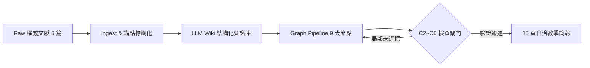

# AI Agents LLM Wiki & 15-Slide Teaching Deck System

> **國立臺灣大學 (NTU) COOL #63218 / #62123「生成式AI：文字與圖像生成的原理與實務」第十週成果專案**  
> **A Self-Contained AI Agents Knowledge Wiki & 15-Slide Interactive Teaching Deck with Conditional Check-Loops & Evaluator-Optimizer Graph Pipeline**


---

## 🌐 線上展示體驗 (Live Demos)

無需下載安裝任何套件，點擊以下連結即可於瀏覽器直接體驗：

- 📖 **[AI Agents LLM Wiki 結構化知識庫瀏覽器](https://034884851.github.io/llm-wiki-ai-agents/)**  
  依據 Andrej Karpathy LLM Wiki 模式設計，攝取 6 篇權威文獻、12 大核心概念與 80 個錨點引用段落，支援即時全文檢索與雙向引用追蹤。
- 🖥️ **[15 頁自洽教學簡報 (Teaching Slide Deck)](https://034884851.github.io/llm-wiki-ai-agents/deck/)**  
  支援鍵盤翻頁（`←` / `→`）、全螢幕切換、進度條刻度，每頁內嵌可展開之「Wiki 原文段落證據抽屜」，兼具生動比喻與嚴謹學術推導。

---

## 📖 專案背景與核心架構 (System Overview)

本專案圍繞第十週課程核心主題**「把你的工作拆成 AI 能做的流程」**，建構了一套自洽的端到端生成式工作流：



### 1. 攝取 6 份核心權威文獻
1. **Anthropic (2024)**：《Building Effective Agents》
2. **Lilian Weng / OpenAI (2023)**：《LLM Powered Autonomous Agents》
3. **Yao et al. / Princeton & Google (2022)**：《ReAct: Synergizing Reasoning and Acting in Language Models》
4. **OpenAI (2025)**：《A Practical Guide to Building Agents》
5. **Hugging Face (2025)**：《Agents Course — Unit 1: What are Agents?》
6. **Anthropic / MCP Open Source (2024)**：《Model Context Protocol (MCP) — Introduction》

### 2. 帶條件檢查閘門的 Graph Pipeline (Evaluator-Optimizer)
- **Node 1 ~ Node 9**：涵蓋 `Fetch` → `Ingest` → `Lint` → `Query` → `Outline` → `Draft` → `Fact-Check` → `Render` → `Validate`。
- **Gate C2 ~ C6 質量閘門**：落實「左移檢核（Shift-Left Testing）」，在早期抓出格式與事實疑義，避免後期全局大重做。
- 詳細架構圖請參閱：[`docs/loop-graph.md`](docs/loop-graph.md)。
- 兩次實施日誌對比請參閱：[`docs/reflection.md`](docs/reflection.md)。

---

## 📂 專案檔案結構 (Project Structure)

```text
llm-wiki-ai-agents/
├── README.md                      # 專案首頁、GitHub Pages 入口說明與導覽
├── index.html                     # 互動式 LLM Wiki 知識庫瀏覽器 (GitHub Pages 根目錄)
├── deck/
│   └── index.html                 # 15 頁自洽教學簡報 (含鍵盤翻頁與全螢幕投影)
├── docs/
│   ├── loop-graph.md              # 條件檢查迴圈與 Graph 拓撲架構圖
│   └── reflection.md              # v1 baseline vs v2 shift-left 運行反思報告
├── submission.md                  # NTU COOL 作業完整繳交報告
└── .gitignore                     # Git 忽略配置
```

---

## 🚀 本地離線運行指南 (Local Usage)

本專案堅持 **零外部依賴（Zero Dependencies）** 原則，無需安裝 Node.js 或執行 `npm install`：

```bash
# 1. 複製儲存庫
git clone https://github.com/034884851/llm-wiki-ai-agents.git
cd llm-wiki-ai-agents

# 2. 直接以任何瀏覽器開啟
open index.html        # 開啟 LLM Wiki 知識庫
open deck/index.html   # 開啟 15 頁自洽教學簡報
```

---

## 🎓 課程與作者資訊 (Course & Author)

- **課程名稱**：國立臺灣大學 NTU COOL #63218 / #62123「生成式AI：文字與圖像生成的原理與實務」
- **學生作者**：劉正祥 (11341461)
- **作業期數**：第十週作業（W10）
